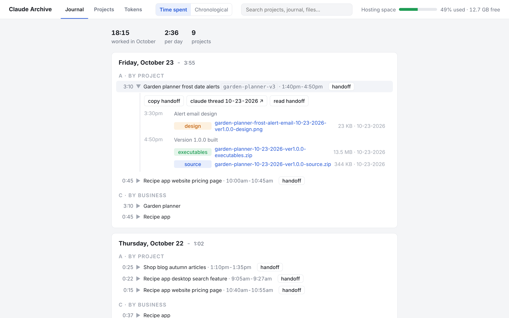
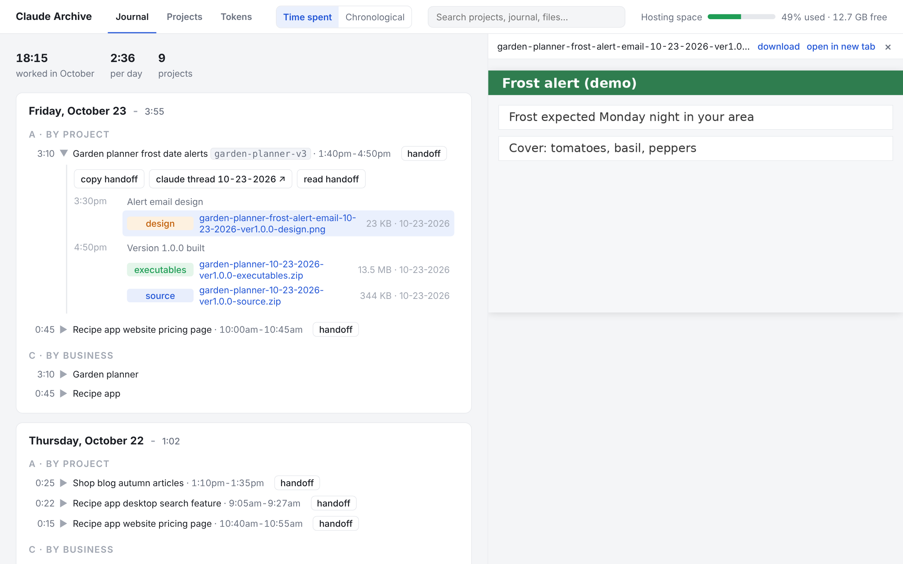
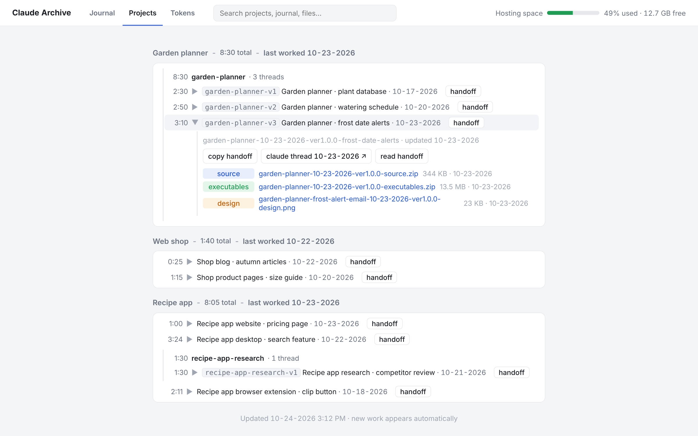
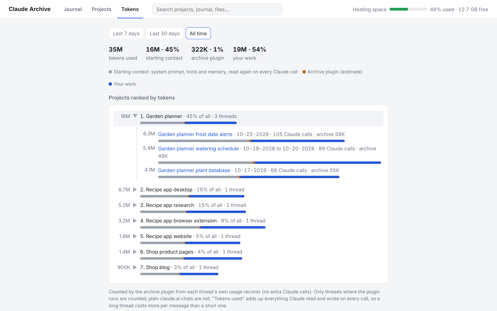

# Claude Archive: save tokens and archive files automatically to Nextcloud

Long Claude threads use more tokens because Claude processes the whole conversation again with every reply. Claude Archive lets you hand off your work to a fresh Claude thread at any time: press **handoff** next to a project in your archive page, paste the copied text as the only message in a new thread, and Claude loads the handoff doc and continues the work.

It also saves Claude's finished files to your own Nextcloud, writes your work journal for you, enforces a file naming rule, and shows all of it on one page on your own web host. Once installed, every Claude thread does all of this on its own. It works in Claude Cowork and Claude Code.

Two parts:

- **The plugin** (`plugin/`) runs inside Claude. After each reply it uploads new files, records the journal and keeps a handoff doc per thread.
- **The viewer** (`viewer/`) is a small PHP app on your web host that shows the archive. You open it at your own web address plus the folder you upload the viewer to, for example https://my-site.com/archive/. It updates itself within about 20 seconds of Claude saving something.

Nextcloud is only the file store. You never have to open it.

## What it does

- **Hands off to a fresh thread in one paste.** Send `handoff` in a thread and Claude writes a handoff doc with the goal, decisions, current state, and next steps (it also does this on its own once a thread passes 150K tokens). Threads form numbered chains: paste `continue recipe-app-v3` as the only text in a new thread, and Claude loads the doc and continues the work there. The **handoff** button on the archive page copies that line for you.
- **Shows the thread size after every reply.** A one-line note such as `112K continue recipe-app-v3` tells you how big the thread is and what to send in a new thread. A thread with nothing saved yet shows `112K send handoff` instead: send `handoff` to give it a name. The note costs no extra Claude call.
- **Shows where your tokens go.** The Tokens tab lists the tokens used per day, per project and per thread, how much of that is the starting context, and an estimate of the share used by the archive plugin itself. The plugin reads these numbers from the thread's transcript, with no extra Claude call.
- **Writes your work journal automatically.** The journal shows, for each day, the time spent per project and per business, when each thread started and ended, your own notes, and each finished file. You can look up what you did on any day without taking notes.
- **Adds your own journal entries.** Send `journal: called the print shop about labels` as its own message in any thread, and the plugin adds that line to today's journal with the current time.
- **Saves your deliverables.** At the end of each Claude reply, the plugin uploads new files from Claude's outputs folder to the thread's Nextcloud folder. If Claude changed other work, the plugin tells Claude to copy it to the outputs folder first. The plugin skips files already on the server.
- **Tracks time.** Monthly total, average per day, and time per project and per business. Gaps longer than 15 minutes don't count, and when threads overlap, the plugin counts the shared time once.
- **Shows every file with one click.** Images, HTML, PDF, Markdown and text open in a pane on the right of the page; zip and other binary files download. Only the newest version of each file is listed; older versions are tucked away under "previous versions".
- **Enforces naming.** Every file Claude saves needs a name like `recipe-app-desktop-10-20-2026-ver2.3.5-source.zip`. The plugin skips badly named files and lists them so Claude can rename them.
- **Searches everything.** One search box covers project names, topics, journal lines, file names and notes.

## Why it helps

### It saves you tokens

The usual fix for a long, expensive thread is to stop, write up notes or a CLAUDE.md file, and start a new thread with that context. Writing those notes takes effort, and you can easily leave something out.

The size note after each reply shows when a thread is getting expensive. To switch threads, send `handoff`, then paste the `continue <chain>-v<N>` line as the only message in a new thread. Claude in the new thread loads the doc, uses the same Nextcloud folder, and continues the work. The Tokens tab shows which projects and threads used the most tokens.

### Your journal writes itself

You never have to write the journal. The plugin logs each thread's topic, time spent, and finished files while the thread runs. To add a note by hand, send `journal:` followed by your note as its own message in any thread.

### Every thread follows the rules without being told

Claude names your files by the rule, saves them to your Nextcloud, and writes handoff docs without you asking. At the end of each reply, the plugin's hooks tell Claude what to do, so you never have to repeat the rules.

### File names you can trust

Claude is often careless with file names. The plugin skips any file that breaks the rule, so Claude has to rename that file before the plugin uploads it.

File names: `<project>-<mm-dd-yyyy>-ver<X.Y.Z>-<type>.<ext>` (a folder Claude saves follows the same rule without the extension)

- **project**: the exact product and component, e.g. `recipe-app-desktop` instead of `recipe`.
- **mm-dd-yyyy**: the day the file was made.
- **verX.Y.Z**: the version of what's inside. Claude bumps it for every new build.
- **type**: one of source, executables, documentation, installer, plugin, assets, images, design, data, config, report, or backup. You can change the list with `file_types`.
- **format**: all lowercase, no spaces, with hyphens between parts.

Example: `recipe-app-desktop-10-20-2026-ver2.3.5-source.zip`

Thread folder names: `<project>-<mm-dd-yyyy>-ver<X.Y.Z>-<what-was-done>`, e.g. `recipe-app-desktop-10-20-2026-ver2.3.5-search-feature`. The version is that of the thread's main deliverable. If the version changes during the thread, Claude picks the new name, and the plugin renames the folder and updates its links in the journal.

## What it looks like

All screenshots show made-up example data.

The Journal tab. Each day lists the time per project (A) and per business (C). A thread that is part of a chain shows its name, like `garden-planner-v3`. Open a project to see its buttons and files; **handoff** copies the text to paste into a new thread:



Click a file and it opens in a pane on the right, with download and open-in-new-tab links:



The Projects tab groups every project folder by business, with total time, last worked date, and the newest version of each file. The threads of one chain (`garden-planner-v1`, `-v2`, `-v3`) stay together in one group:



The Tokens tab shows the tokens used in the last 7 days, the last 30 days, or all time. Each project and thread has a bar split into starting context (grey), the archive plugin (orange), and your work (blue):



## Requirements

- Claude Cowork or Claude Code. Plain claude.ai chat does not run plugin hooks, so the plugin does not work there.
- A Nextcloud server where you have an admin account (the plugin logs in as its own Nextcloud user).
- `python3` (3.9 or newer) and `curl` where Claude runs.
- For the viewer: a web host with PHP 8.1 or newer, with the `pdo_sqlite`, `curl` and `dom` extensions (standard on most shared hosting), and a cron job. The viewer can live on the same host as Nextcloud, in a subfolder, or anywhere else.

## Setup with Claude (easiest)

Paste this prompt into a new Claude Cowork or Claude Code thread. Claude asks you what it needs to know and does the rest.

```
Set up Claude Archive for me (plugin and viewer), start to finish: https://github.com/ckck2030/claude-save-tokens-and-archive-files-automatically-to-nextcloud

Before you start, ask me everything you need in one short numbered list, unless you already know the answer. Include at least:
- Do I already have a Nextcloud server? If yes, its URL. If no, help me choose one (a managed Nextcloud provider or my own web host) and walk me through getting it running.
- Which web host runs PHP for the viewer (it can be the same host as Nextcloud), and at which address should the archive page appear (for example https://my-site.com/archive/)? How do you get files onto it (cPanel file manager, SFTP, or me uploading)?
- Can you work in my browser (e.g. with Claude in Chrome), or should I do the clicks myself?
- What is my timezone?
- What should the archive folder be called (default: claude)?

Then do these steps in order. Do every step you can yourself; when only I can do something (logging in, creating a password), tell me exactly what to click and wait for me.
1. In Nextcloud, create a user named "claude" with its own password. In my admin account, create the archive folder and share it with the "claude" user, with edit rights. Check that the folder appears at the top level of the "claude" user's Files under the same name, and delete the default files Nextcloud gives new users so the "claude" user sees nothing else.
2. Log in as "claude", go to Settings > Security > Devices & sessions, and create an app password named "claude-archive". Let me choose whether to paste it into this chat or type it into the config files myself. Never show it in your replies.
3. Download the repository from GitHub.
4. Viewer: upload the viewer/ folder to my web host at the address I chose. On the host, run "php setup.php" in that folder (over SSH or the cPanel terminal); it asks for the Nextcloud login, the archive folder name, the timezone, and a sign-in name and password for the page, then writes config.php and prints a viewer_url and viewer_token for the plugin. If I have no terminal access, copy config.example.php to config.php, fill it in, make login_hash with PHP's password_hash() and refresh_token a long random string, and run import.php once through the browser-free way you have. Add an hourly cron job that runs "php <path to viewer>/import.php". Check that the page opens at my address and that I can sign in.
5. Plugin: copy plugin/config.example.json to plugin/config.json and fill in host, user, password, root_folder, timezone, viewer_url and viewer_token. Set outputs_dir to the folder where you save finished files in this app and scan_root to the folder where you build work.
6. From the plugin folder, run "python3 scripts/archive.py test" and fix any error before going on.
7. Package the plugin folder (config.json included) as a .plugin zip file, give it to me, and tell me exactly how to install it in the app I'm using.
8. After I install it, have me start a new thread and give it a small task that needs a few tool calls (e.g. create and save a short file), then check that the thread appears on the archive page within a minute.

Finish with a short summary: the address of my archive page, where my files are in Nextcloud, and how to continue a thread later (press "handoff" on the archive page and paste the copied text as the only message in a new thread).
```

## Manual setup

### 1. Nextcloud

1. Create a user for Claude (e.g. `claude`). Log in as that user and create an app password named `claude-archive` (Settings > Security > Devices & sessions).
2. In your admin account, create a folder for the archive (e.g. `claude`) and share it with the `claude` user with edit rights. Make sure the folder appears at the top level of the `claude` user's Files under the same name and that the `claude` user sees no other files.

### 2. Viewer

1. Upload the `viewer/` folder to your web host, into the folder that matches the address you want. For example, uploading it to `public_html/archive/` on a site called `my-site.com` gives you the page at `https://my-site.com/archive/`.
2. On the host, open a terminal in that folder and run `php setup.php`. It asks for the Nextcloud URL, user, app password, archive folder name, timezone, and the sign-in name and password for the page. It writes `config.php` (with only the hash of the page password), builds the database once, and prints the `viewer_url` and `viewer_token` lines for the plugin.
   Without a terminal: copy `config.example.php` to `config.php` and fill it in by hand; `login_hash` is PHP's `password_hash()` of your page password and `refresh_token` any long random string.
3. Make sure PHP can write to `viewer/data/` (it holds the SQLite database). The `.htaccess` there blocks web access to it; on nginx, deny access to `data/` yourself.
4. Add a cron job that runs `php /path/to/viewer/import.php` once an hour. It is only a safety net: the plugin triggers a rebuild after every save.
5. Open the page at your address and sign in with the name and password you chose. The cookie keeps you signed in for a year.

### 3. Plugin

1. Copy `plugin/config.example.json` to `plugin/config.json` and fill in your server, user, app password, folder name, timezone (e.g. `America/New_York`), and the `viewer_url` and `viewer_token` from setup.php. If Claude runs on your own computer, also set `outputs_dir` and `scan_root` (see Config options).
2. From the plugin folder, run `python3 scripts/archive.py test`. It prints OK when the login works and the archive folder is found.
3. Zip the plugin folder (with `config.json` inside) as a `.plugin` file and install it in Claude Cowork or Claude Code.

`config.json` and `config.php` hold passwords, so they are in `.gitignore`. Never commit them, and never share your `.plugin` file, which contains the password too. To change a plugin setting later, edit `config.json` and reinstall the plugin.

## How live updates work

1. Claude finishes a reply. The plugin's Stop hook starts a background job that uploads new files, records the journal and the token counts. This needs no extra Claude call.
2. After each of those, the plugin sends one small POST to `refresh.php` on your viewer with the `viewer_token`. The viewer answers at once and rebuilds its database in the background (one rebuild at a time; a second request waits and then rebuilds again, so nothing is missed).
3. The archive page, while its tab is visible, reads a tiny timestamp file every 20 seconds and reloads the data only when it changed. Open sections, scroll position and the file pane stay as they were. The page never talks to Nextcloud itself; only `import.php` and `file.php` do.
4. The hourly cron job rebuilds the database too, in case a POST was lost.

## Good to know

- The archive step runs in the background when Claude finishes a reply and adds no Claude calls. Handoff docs are written by Claude, so they cost one short step when you ask for one.
- **claude thread** buttons appear only for cloud threads, such as Claude Cowork or Claude Code on the web. In a local Claude Code terminal, the thread's address is not available, so the plugin leaves those out.
- If you change the app password, user, or host, update `config.json` and reinstall the plugin, and run `php setup.php` again for the viewer.
- Inside Claude, the plugin is named `claude-archive`.
- The hosting space meter in the top bar appears if a file `journal/hosting-space.json` exists in the archive folder with the keys `mb_used`, `mb_limit` and `checked` (ISO time). A cron script on your host can write it; it is optional.
- We tested with Nextcloud 35, PHP 8.4 on cPanel, Chrome and Firefox.

## Uninstall

The plugin installs nothing on your Nextcloud server. It only logs in as the `claude` user and reads and writes files in the archive folder (including a hidden `.state` folder), like any sync app. After the steps below, your Nextcloud is back to how it was, apart from the files you choose to keep.

### Uninstall with Claude

Paste this prompt into a Claude Cowork or Claude Code thread:

```
Uninstall Claude Archive for me completely (plugin and viewer): https://github.com/ckck2030/claude-save-tokens-and-archive-files-automatically-to-nextcloud

Before deleting anything, ask me in one short numbered list:
- Should you keep or delete my archived files and journal in Nextcloud? (If I keep them, the archive folder stays in my admin account.)
- Can you work in my browser (e.g. with Claude in Chrome), or should I do the clicks myself?

Then do these steps. Do every step you can yourself; when only I can do something, tell me exactly what to click and wait for me.
1. Remove the claude-archive plugin from this app and tell me how to confirm it is gone.
2. Delete the plugin's local data folder ~/.claude-archive (it holds a saved copy of the login).
3. On my web host, remove the viewer's cron job and delete the viewer folder (it holds config.php with the Nextcloud app password and the data/ database).
4. In Nextcloud, as the "claude" user, go to Settings > Security > Devices & sessions and revoke the "claude-archive" app password.
5. As the admin, delete the "claude" user. The archive folder belongs to the admin account, so the files stay unless I chose to delete them.
6. Do what I chose for the archive folder.

Finish by listing what was removed and what was kept.
```

### Uninstall manually

1. Remove the plugin (named `claude-archive` inside Claude) from Claude Cowork or Claude Code.
2. Delete the `~/.claude-archive` folder on the machine where Claude runs (it holds a saved copy of the login).
3. On your web host, remove the cron job and delete the viewer folder.
4. In Nextcloud, log in as `claude`, open Settings > Security > Devices & sessions, and revoke the `claude-archive` app password.
5. Log in as the admin and delete the `claude` user (Users page). Your archive folder stays in the admin account.
6. Optional: delete the archive folder.

## Config options

### Plugin (`plugin/config.json`)

| Key | Meaning | Default |
| --- | --- | --- |
| `host` | Nextcloud URL | required |
| `user` | Nextcloud user Claude logs in as | required |
| `password` | That user's app password | required |
| `root_folder` | Archive folder shared with that user | `claude` |
| `timezone` | IANA timezone for dates and journal times | `UTC` |
| `outputs_dir` | Folder Claude writes deliverables to | `/mnt/user-data/outputs` |
| `scan_root` | Folder checked for changed work not yet archived | `/home/claude` |
| `file_types` | Allowed values for the type part of file names | source, executables, documentation, installer, plugin, assets, images, design, data, config, report, backup |
| `viewer_url` | Address of the viewer's `refresh.php` | none (no live updates) |
| `viewer_token` | The `refresh_token` from the viewer's `config.php` | none |

### Viewer (`viewer/config.php`, made by `setup.php`)

| Key | Meaning |
| --- | --- |
| `host`, `user`, `password`, `root` | The same Nextcloud login as the plugin; `root` is the archive folder with a leading slash |
| `timezone` | IANA timezone, used for the times shown |
| `login_user`, `login_hash`, `cookie_days` | Sign-in for the page; the hash is `password_hash()` of the page password |
| `refresh_token` | Secret the plugin must send to `refresh.php` |
| `skip` | Top-level folders in the archive that are not projects |
| `business_by_topic`, `business_by_folder` | Optional grouping of projects under a business or client name (regular expression on the topic, or folder-name prefix). Unmatched folders are grouped by their first word |
| `words` | Optional spelling of short words in project names, e.g. `'ai' => 'AI'` |

## Commands

You don't need these in normal use. Run them from the plugin folder:

```
python3 scripts/archive.py test                       # check the Nextcloud login and archive folder
python3 scripts/archive.py checkname <file name>      # check a file name
python3 scripts/archive.py checkfolder <folder name>  # check a folder name
python3 scripts/archive.py tidy --all                 # move older file versions into older-versions/ in every project folder
php import.php                                        # (in the viewer folder) rebuild the viewer's database now
```

## Security notes

- The plugin keeps the password only in `config.json` (and so in your `.plugin` file) and in a private netrc file, `~/.claude-archive/.netrc` (mode 600), that curl reads. The password never appears on the command line.
- The plugin connects only through WebDAV with the `claude` login and creates no public share links.
- The viewer stores only a hash of the page password. `data/` is blocked from the web by `.htaccess`. `file.php` and `view.php` refuse paths with `..`, and every page except `refresh.php` requires the sign-in cookie; `refresh.php` requires the token.

## License

MIT
